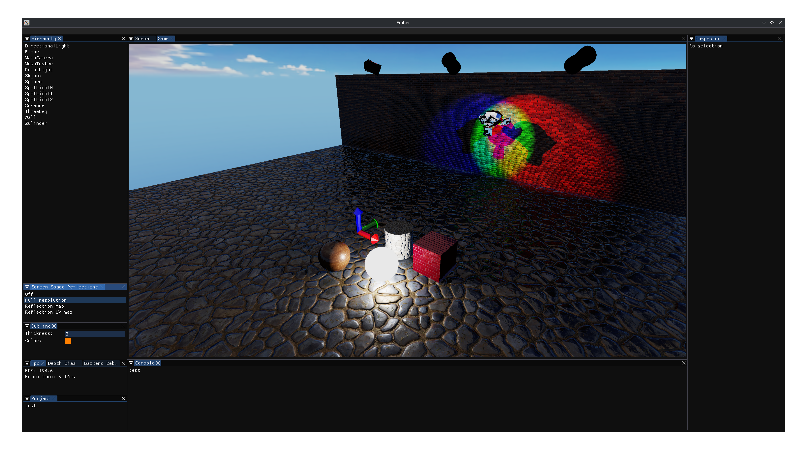
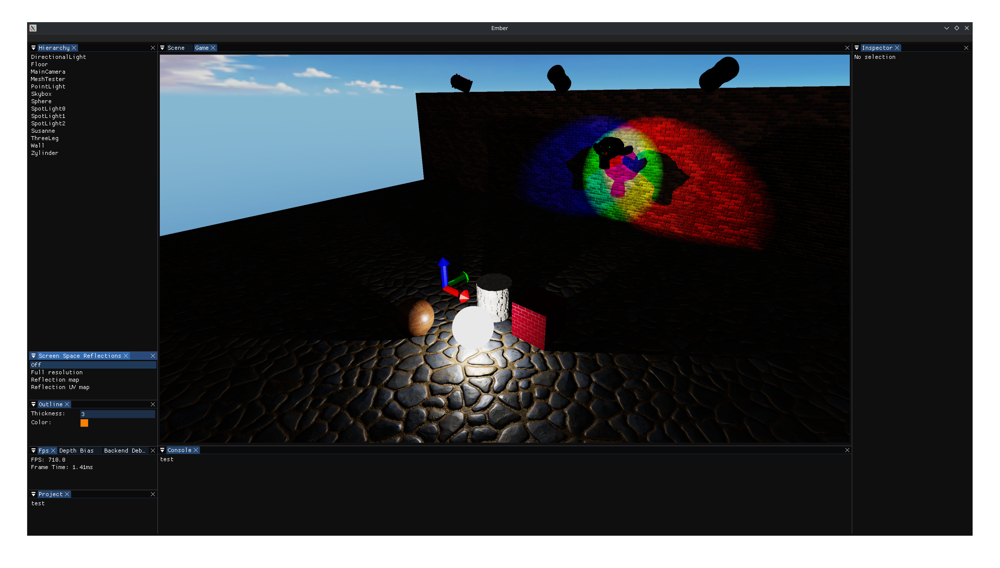

# Preview

On this page you can find some highlights of renderer techniques implemented in ember.

## Screen-space reflections

Ember supports a screen space compute stage, which runs on the graphics queue right after the deferred lighting and before the forward opaque stage.
This allows for the implementation of screen space techniques, such as screen space reflections, which allow geometry to reflect any of the visibly drawn geometry and the full skybox.

<figure class="ssr-comparison" data-ssr-comparison>
  

    

      SSR off
      710.0 FPS
    

    <button class="ssr-comparison__fullscreen" type="button" data-ssr-fullscreen aria-label="Enter fullscreen" aria-pressed="false" title="Enter fullscreen">
      <svg viewBox="0 0 24 24" fill="none" stroke="currentColor" stroke-width="1.8" stroke-linecap="round" stroke-linejoin="round" aria-hidden="true"><path d="M8 3H3v5m13-5h5v5M3 16v5h5m13-5v5h-5"/></svg>
      Fullscreen
    </button>
    

      Full resolution
      194.6 FPS
    

  

  

    
    
    

      
        <svg viewBox="0 0 24 24" fill="none" stroke="currentColor" stroke-width="1.8" stroke-linecap="round" stroke-linejoin="round"><path d="m8 7-5 5 5 5m8-10 5 5-5 5"/></svg>
      
    

    <input class="ssr-comparison__slider" type="range" min="0" max="100" step="0.1" value="50" aria-label="Screenshot divider position" aria-valuetext="50% SSR off, 50% Full resolution" aria-describedby="ssr-comparison-help">
  

  <fieldset class="ssr-comparison__modes">
    <legend>Right image</legend>
    <label>
      <input type="radio" name="ssr-mode" value="full-resolution" checked data-image="ssrFullResolution.png" data-name="Full resolution" data-fps="194.6">
      Full Resolution194.6 FPS
    </label>
    <label>
      <input type="radio" name="ssr-mode" value="reflection-map" data-image="ssrReflectionMap.png" data-name="Reflection map" data-fps="322.9">
      Reflection Map322.9 FPS
    </label>
    <label>
      <input type="radio" name="ssr-mode" value="reflection-uv-map" data-image="ssrReflectionUvMap.png" data-name="Reflection UV map" data-fps="317.2">
      Reflection UV Map317.2 FPS
    </label>
  </fieldset>
  

    

	Reflections are traced and applied at the scene's full resolution.

    

	Reflected colors are stored in a separate reflection map at half resolution.
	A second pass composites the reflections into the scene.
	Half resolution sampling leads to reflections beeig at half resoluton, which is noticable on flat reflective surfaces.

    

	Reflection hit coordinates are stored in a uv map at half resolution.
	A second pass samples the scene color at those coordinates and composites the reflections into the scene.
	Using the sampled uvs to access the scene color texture resolves the reflections at full resolution, but can lead to artifacts on geometry boundaries.

  

  

</figure>

The 'Reflection Map' and 'Reflection UV Map' achieve very similar results to the 'Full Resolution' approach with twice as many fps. 
See the [rendering pipeline](../vulkan-renderer/rendering-pipeline.md) for how rendering and compute passes fit together.

## Fluid dynamics

The fluid dynamics project runs a three-dimensional smoothed-particle hydrodynamics (SPH) simulation on the GPU.
These recordings show its particle, water, and cloud rendering modes.

### Particle rendering (300fps)

Each particle is rendered as a camera facing billboard quad via instanced rendering, reading its position and color (density) from the sph gpu buffers.
A custom shader turns the quads into 3d looking spheres and updates their depth according to a sphere.

<video controls playsinline preload="none" poster="particleShader.jpg" width="3840" height="2086" style="width: 100%; height: auto;" aria-label="SPH fluid simulation rendered as individual particles">
  <source src="particleShader.webm" type='video/webm; codecs="av01.0.13M.10"'>
  Your browser does not support embedded WebM video. <a href="particleShader.webm">Download the particle rendering video</a>.
</video>

### Water rendering (80fps - 100fps)

The water shader is a ray marching algorithm which reconstructs the fluids surface via marching through the fluid simulation volume and detecting a density threshold.
At each detected surface, the ray splits into reflected and refracted rays, up to four times following Snell's law, $n_0 \sin(\theta_0) = n_1 \sin(\theta_1)$.
The water shader is implemented in the forward transparent render stage, giving it access to the scene color with all opaque geometry already rendered.
This allows reflecting and refracting the visible scene, similar to screen space reflections, and the full skybox, which also acts as a fallback for any ray that misses all geometry.

<video controls playsinline preload="none" poster="waterShader.jpg" width="3840" height="2086" style="width: 100%; height: auto;" aria-label="SPH fluid simulation rendered as reflective and refractive water">
  <source src="waterShader.webm" type='video/webm; codecs="av01.0.13M.10"'>
  Your browser does not support embedded WebM video. <a href="waterShader.webm">Download the water rendering video</a>.
</video>

### Volumetric rendering (350fps)

Cloud mode uses a volumetric shader which ray marches through the volume and accumulates light through scattering and absorption with every step.
The directional light similarly renders a optical depth 3d texture which is used for volumetric lighting, allowing the fluid to cast shadows on itself.

<video controls playsinline preload="none" poster="volumetricShader.jpg" width="3840" height="2086" style="width: 100%; height: auto;" aria-label="SPH fluid simulation rendered as a cloud-like volume">
  <source src="volumetricShader.webm" type='video/webm; codecs="av01.0.13M.10"'>
  Your browser does not support embedded WebM video. <a href="volumetricShader.webm">Download the volumetric rendering video</a>.
</video>