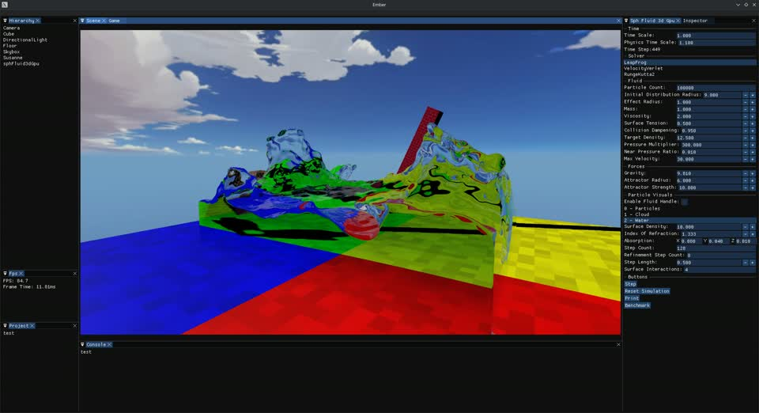

---
hide:
  - navigation
  - toc
---

# Ember Engine

Ember is a modular C++ game engine and real-time rendering project based on Vulkan, SDL3, and DearImGui.

Explore rendering and simulation demonstrations in the showcase, or read the documentation to understand the engine's architecture and how its systems work together.

[Explore the showcase](../showcase/index.md){ .md-button .md-button--primary }
[Read the documentation](../documentation/index.md){ .md-button }

## Showcase

The [fluid dynamics showcase](../showcase/fluidDynamics/index.md) demonstrates GPU particle simulation with particle, water, and volumetric rendering. The [screen-space reflections showcase](../showcase/screenSpaceReflections/index.md) lets you compare rendering modes and their performance.

## Documentation

The [documentation](../documentation/index.md) introduces the engine's architecture. The [Vulkan renderer guides](../documentation/vulkan-renderer/index.md) explain frame execution, rendering stages, compute, GPU resources, and resource lifetime.

## More from Tom Olsen

[Source code](https://github.com/Tom-Olsen/Ember) · [Portfolio](https://tom-olsen.github.io/Tom-Olsen/) · [Sparkive lessons](https://tom-olsen.github.io/sparkive/)